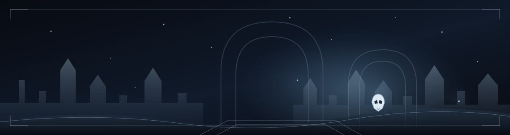

# HENRIQUE SANTANA

### Desenvolvedor de Software · Front-end & Back-end

Explorando ideias, construindo experiências e transformando linhas de código em projetos.

 

 

✦ THE KNIGHT'S ARCHIVE · PERSONAL DEVELOPER PROFILE ✦

---

## ❖ Sobre mim

Sou desenvolvedor júnior com foco na construção de interfaces web e aplicações. Trabalho principalmente com **TypeScript**, **JavaScript**, **Tailwind CSS**, **Java** e **PostgreSQL**, buscando unir organização técnica, usabilidade e identidade visual.

> **REGISTRO DO VIAJANTE**
>
> **FORMAÇÃO** · Desenvolvimento de Sistemas — SENAI  
> **FOCO** · Front-end, back-end e aplicações web  
> **BASE** · Serra, Espírito Santo — Brasil  
> **STATUS** · Aberto a oportunidades em TI

## ❖ Arsenal técnico

  

GSAP · SQL · LÓGICA DE PROGRAMAÇÃO · ALGORITMOS · DOCUMENTAÇÃO TÉCNICA

## ❖ Projetos em exploração

| PROJETO | REGISTRO | ACESSO |
| :-- | :-- | :-- |
| **EMBER MUSIC** | Player web com busca, playlists, artistas, biblioteca local, autenticação Google e interface responsiva. | [DEMO](https://ember-music-five.vercel.app/) · [CÓDIGO](https://github.com/henrisantana07/ember-music) |
| **CONTOS DERRY** | Experiência de livraria de terror com coleções, destaques e navegação responsiva. | [DEMO](https://contos-derry-1.vercel.app/) |
| **VECTRA** | Solução visual de automação logística, com funcionalidades, proposta de valor e contato comercial. | [DEMO](https://vectra4-1.vercel.app/) |
| **PORTFÓLIO** | Espaço pessoal para reunir projetos, trajetória e contato. | [DEMO](https://portifolio-bay-zeta.vercel.app) · [CÓDIGO](https://github.com/henrisantana07/Portifolio) |

## ❖ Sinais de atividade

## ❖ O salão de contribuições

Cada contribuição é mais um passo nessa jornada. Meu histórico do GitHub em modo arcade.

## ❖ Linha do tempo

## ❖ Entre em contato

Tem uma oportunidade, ideia ou projeto? Vamos conversar.

  

「 Mesmo nas profundezas, sempre há algo novo a descobrir. 」

  

