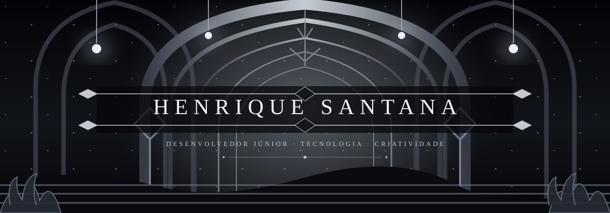

<div align="center">



<a href="https://portifolio-bay-zeta.vercel.app">
  
</a>

<br/><br/>

<a href="https://portifolio-bay-zeta.vercel.app"></a>
<a href="https://portifolio-bay-zeta.vercel.app/curriculo.pdf"></a>
<a href="https://www.linkedin.com/in/henrique-santana-017b45223"></a>
<a href="mailto:henrisantana07@gmail.com"></a>

</div>

---

## ◈ SOBRE

Desenvolvedor júnior. Construo interfaces web com **TypeScript**, **Tailwind**, **Java** e **PostgreSQL**.

```text
formação   → Desenvolvimento de Sistemas · SENAI (2024–2026)
foco       → front-end e back-end
local      → Serra, ES — Brasil
status     → aberto a oportunidades
```

---

## ◈ HABILIDADES

<div align="center">

**DESENVOLVIMENTO**

`TypeScript` · `JavaScript` · `HTML5` · `CSS3` · `Tailwind CSS` · `Java`

**FERRAMENTAS E TECNOLOGIAS**

`PostgreSQL` · `Git` · `GitHub` · `Vercel` · `VS Code` · `GSAP`

**FUNDAMENTOS**

`SQL` · `LÓGICA` · `ALGORITMOS` · `DOCUMENTAÇÃO TÉCNICA`

</div>

---

## ◈ PROJETOS RECENTES

| PROJETO | DESCRIÇÃO | LINKS |
| :-- | :-- | :-- |
| **EMBERMUSIC**<br/><sub>`MÚSICA · PLAYER WEB`</sub> | Player web com busca, playlists, artistas e biblioteca local. Login com Google e layout responsivo | [`DEMO`](https://ember-music-five.vercel.app/) · [`CÓDIGO`](https://github.com/henrisantana07/ember-music) |
| **CONTOS DERRY**<br/><sub>`LIVRARIA DE TERROR · E-COMMERCE`</sub> | Landing page temática com vitrine de coleções, destaques de títulos e navegação responsiva | [`DEMO`](https://contos-derry-1.vercel.app/) |
| **VECTRA**<br/><sub>`AUTOMAÇÃO · LOGÍSTICA`</sub> | Landing page de solução de automação logística, com funcionalidades, proposta de valor e contato comercial | [`DEMO`](https://vectra4-1.vercel.app/) |
| **PORTFÓLIO**<br/><sub>`SITE PESSOAL`</sub> | Projetos, trajetória e contato em um só lugar | [`DEMO`](https://portifolio-bay-zeta.vercel.app) · [`CÓDIGO`](https://github.com/henrisantana07/Portifolio) |

---

## ◈ STATUS

<div align="center">


</div>

---

## ◈ ARCADE

Cada contribuição, um inimigo a menos. Meu histórico em modo Galaga.

<div align="center">


</div>

---

## ◈ TRAJETÓRIA

<div align="center">
  
</div>

---

## ◈ CONTATO

Prefere escrever? Respondo em até um dia útil.

<div align="center">

<a href="mailto:henrisantana07@gmail.com"></a>
<a href="https://wa.me/5527997612988?text=Ol%C3%A1!%20Vi%20seu%20GitHub."></a>
<a href="https://www.linkedin.com/in/henrique-santana-017b45223"></a>

</div>
