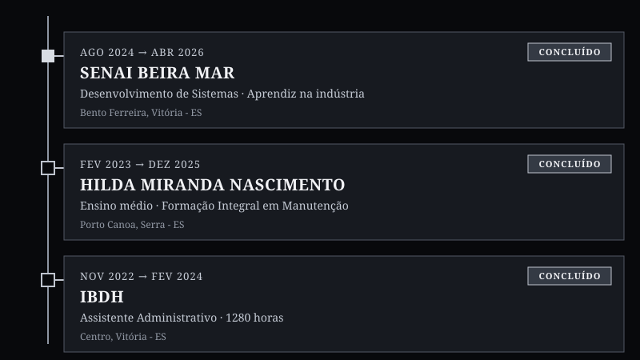

<div align="center">


<a href="https://portifolio-bay-zeta.vercel.app">
  
</a>

<br/><br/>

<a href="https://portifolio-bay-zeta.vercel.app"></a>
<a href="https://portifolio-bay-zeta.vercel.app/curriculo.pdf"></a>
<a href="https://www.linkedin.com/in/henrique-santana-017b45223"></a>
<a href="mailto:henrisantana07@gmail.com"></a>

</div>

---

<h2 align="center"></h2>
Desenvolvedor júnior. Construo interfaces web com **TypeScript**, **Tailwind**, **Java** e **PostgreSQL**.

```text
formação   → Desenvolvimento de Sistemas · SENAI (2024–2026)
foco       → front-end e back-end
local      → Serra, ES — Brasil
status     → aberto a oportunidades
```

---

<h2 align="center"></h2>
<div align="center">

<table>
  <tr>
    <td align="center" width="120"><br/><sub><b>TYPESCRIPT</b></sub></td>
    <td align="center" width="120"><br/><sub><b>JAVASCRIPT</b></sub></td>
    <td align="center" width="120"><br/><sub><b>HTML5</b></sub></td>
    <td align="center" width="120"><br/><sub><b>CSS3</b></sub></td>
    <td align="center" width="120"><br/><sub><b>TAILWIND CSS</b></sub></td>
    <td align="center" width="120"><br/><sub><b>JAVA</b></sub></td>
  </tr>
  <tr>
    <td align="center" width="120"><br/><sub><b>POSTGRESQL</b></sub></td>
    <td align="center" width="120"><br/><sub><b>GIT</b></sub></td>
    <td align="center" width="120"><br/><sub><b>GITHUB</b></sub></td>
    <td align="center" width="120"><br/><sub><b>VERCEL</b></sub></td>
    <td align="center" width="120"><br/><sub><b>VS CODE</b></sub></td>
    <td align="center" width="120"><br/><sub><b>GSAP</b></sub></td>
  </tr>
</table>

<sub><code>SQL</code> · <code>LÓGICA</code> · <code>ALGORITMOS</code> · <code>DOCUMENTAÇÃO TÉCNICA</code></sub>

</div>

---

<h2 align="center"></h2>
| PROJETO | DESCRIÇÃO | LINKS |
| :-- | :-- | :-- |
| **EMBERMUSIC**<br/><sub>`MÚSICA · PLAYER WEB`</sub> | Player web com busca, playlists, artistas e biblioteca local. Login com Google e layout responsivo | [`DEMO`](https://ember-music-five.vercel.app/) · [`CÓDIGO`](https://github.com/henrisantana07/ember-music) |
| **CONTOS DERRY**<br/><sub>`LIVRARIA DE TERROR · E-COMMERCE`</sub> | Landing page temática com vitrine de coleções, destaques de títulos e navegação responsiva | [`DEMO`](https://contos-derry-1.vercel.app/) |
| **VECTRA**<br/><sub>`AUTOMAÇÃO · LOGÍSTICA`</sub> | Landing page de solução de automação logística, com funcionalidades, proposta de valor e contato comercial | [`DEMO`](https://vectra4-1.vercel.app/) |
| **PORTFÓLIO**<br/><sub>`SITE PESSOAL`</sub> | Projetos, trajetória e contato em um só lugar | [`DEMO`](https://portifolio-bay-zeta.vercel.app) · [`CÓDIGO`](https://github.com/henrisantana07/Portifolio) |

---

<h2 align="center"></h2>
<div align="center">



</div>

---

<h2 align="center"></h2>
Cada contribuição, um inimigo a menos. Meu histórico em modo Galaga.

<div align="center">



</div>

---

<h2 align="center"></h2>
<div align="center">
  
</div>

---

<h2 align="center"></h2>
Prefere escrever? Respondo em até um dia útil.

<div align="center">

<a href="mailto:henrisantana07@gmail.com"></a>
<a href="https://wa.me/5527997612988?text=Ol%C3%A1!%20Vi%20seu%20GitHub."></a>
<a href="https://www.linkedin.com/in/henrique-santana-017b45223"></a>

</div>
